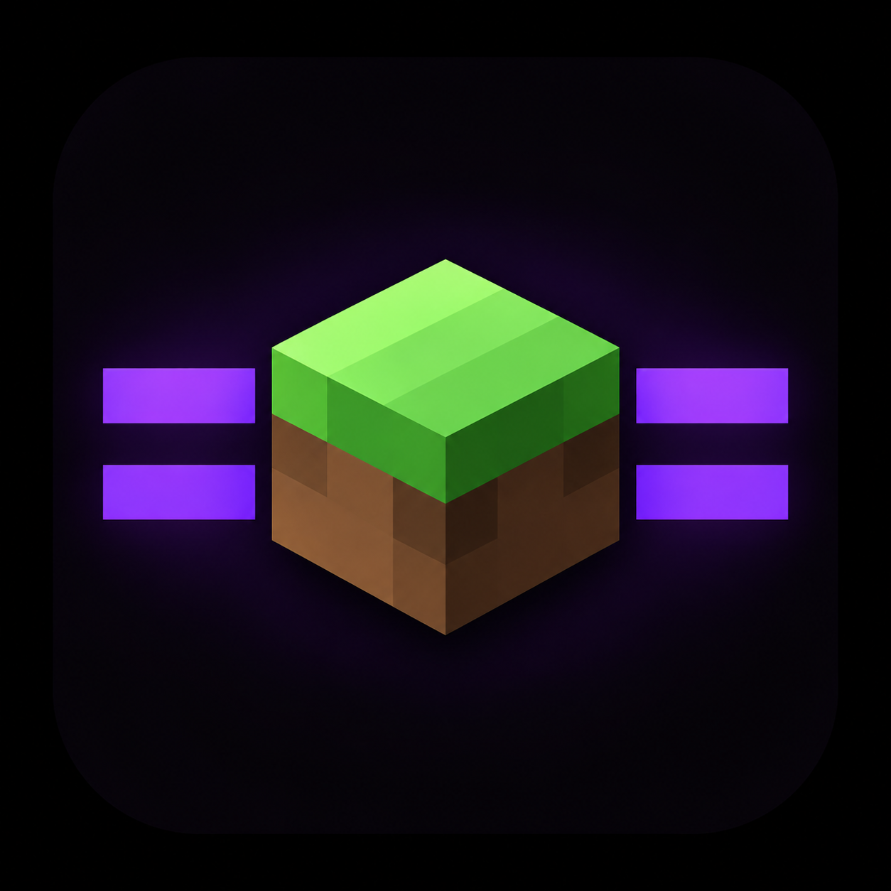

# ZaRust Launcher

  

  <strong>One Android app. Java Edition and Horizon Rust Edition.</strong> 
  The Zalith Launcher 2+ experience and Horizon Rust are brought together in a single launcher.

  
  
  
  

> **Unofficial community project.** ZaRust Launcher is maintained and integrated by **AlfaaBEJIRR**. It is not affiliated with, endorsed by, or an official distribution of the Zalith Launcher, Horizon, Starling, Mojang, or Microsoft teams.

## What is ZaRust Launcher?

**ZaRust Launcher combines the Zalith Launcher 2+ foundation with Horizon Rust Edition inside one Android application.** The goal is simple: players can access both editions from ZaRust instead of installing and switching between separate launcher apps.

| Edition | Technology | Purpose |
| --- | --- | --- |
| **Java Edition** | Zalith Launcher 2+ | The established Java launcher experience, including version management, Java runtimes, accounts, renderers, mods, and launcher settings. |
| **Rust Edition** | Horizon Rust engine + Starling Android port | A native Rust-based game runtime integrated into ZaRust, with Rust-specific settings and an Android launch path. |

Starling is the Android project used to bring the Horizon-based engine to Android. It remains an independently maintained upstream project; ZaRust integrates and adapts it rather than claiming ownership of its engine.

## Project direction

- **One app:** both editions are accessed from the ZaRust Launcher application (package ID: **com.zarust.launcher**).
- **One launcher experience:** Rust Edition is intended to live inside ZaRust's interface, not open a separate Starling launcher.
- **Separate game data:** Java and Rust versions, saves, mods, and runtime files remain separated where their formats and engines differ.
- **Edition-specific settings:** Java settings remain part of the Zalith-based launcher, while Rust-specific options are managed in the Rust Edition section.
- **Input integration:** ZaRust/Zalith controls and Starling controls can be selected where supported by the current integration. Touch, keyboard, and gamepad behavior is still being tested.
- **Local native building:** the experimental Native Builder can prepare a private Android toolchain and compile supported ARM64 Rust native builds on the device. A separate Termux app or remote build worker is not required.

## Native mods and Native Builder

ZaRust has an import and staging path for Horizon native **.hnmod** packages. The experimental on-device Native Builder is designed to apply compatible native packages to a selected Starling Android source base and compile an ARM64 native library locally.

**This feature is not production-ready.** The first setup still installs Rust/Cargo and Android build tools into ZaRust's private storage, and a full native compile needs substantial free internal storage. Current native building is intended for ARM64 Android devices. Package compatibility depends on the Horizon/Starling revision and the contents of each .hnmod.

Native packages contain executable source code. Only import and build packages from sources you trust. Java .jar, Fabric, Forge, NeoForge, Iris, and Sodium mods are not automatically compatible with Horizon Rust Edition.

## Current status

ZaRust is an active community integration project. CI builds are available, but a green APK build does **not** mean every feature has passed real-device gameplay testing.

- General Android APK builds: [GitHub Actions](https://github.com/fathily/ZaRust-Launcher/actions).
- User-facing builds and experimental packages: [Releases](https://github.com/fathily/ZaRust-Launcher/releases).
- The integrated Starling/Horizon Rust Edition build currently targets **Android ARM64 (arm64-v8a)**.
- Other ABI APKs are provided for the launcher build; check each release asset's label before installing.
- Experimental builds may change, be replaced, or be withdrawn as integration bugs are fixed.

## Known issues and unfinished work

Please read this section before installing a pre-release. **There are still known bugs and incomplete integrations.**

- **Touch controls:** switching between Zalith and Starling layouts may not behave consistently in every game screen or after an app update. The control bridge is being corrected and needs more device testing.
- **Keyboard and gamepad:** some mappings and control combinations still need verification.
- **Native Builder:** on-device compilation is experimental, currently ARM64-only, and can fail for unsupported source revisions or native packages. Rust/Cargo and the Android sysroot are installed during preparation; the complete compiler toolchain is not yet fully preinstalled in every build.
- **Storage:** preparing the local build environment and compiling a native runtime requires several gigabytes of free internal storage. The exact requirement depends on cached source and build output.
- **Shaders and mods:** Horizon Rust, Starling, and Minecraft Java use different engine paths and package formats. Do not assume Java shaders or mods will work in Rust Edition.
- **Settings and localization:** some Rust-specific settings and strings may still be incomplete or inconsistent with the launcher's selected language.
- **Device compatibility:** the Rust Edition has not been validated on every Android version, ABI, GPU, controller, or device model.

When reporting a bug, include the ZaRust build or release tag, device model, Android version, ABI, edition, steps to reproduce, and a relevant log. Please report ZaRust integration problems here rather than assuming they are upstream Horizon or Starling bugs.

## Downloads

Go to the **[ZaRust Releases page](https://github.com/fathily/ZaRust-Launcher/releases)** and read the notes attached to each build.

Typical asset names:

| Asset | Intended use |
| --- | --- |
| **ZaRust-<version>-arm64-v8a.apk** | Standard launcher build for 64-bit ARM Android devices. |
| **ZaRust-<version>-armeabi-v7a.apk** | Standard launcher build for 32-bit ARM Android devices. |
| **ZaRust-<version>-x86_64.apk / x86.apk** | Standard launcher builds for the matching x86 ABI. |
| **ZaRust-<version>.apk** | Universal launcher build; larger download, ABI coverage depends on the release. |
| **ZaRust-Starling-Release-arm64-v8a.apk** | Combined Rust Edition build for ARM64 Android devices. |

Prefer the combined Starling/Rust Edition asset when the release notes identify it as available. A standard launcher APK and the Rust-integrated APK are not interchangeable release variants.

## Upstream projects and credits

ZaRust combines and adapts work from independent open-source projects. Their original authors and maintainers retain credit for their own work.

| Project / contributor | Contribution | Source |
| --- | --- | --- |
| **AlfaaBEJIRR** | ZaRust maintainer, integration, launcher modifications, UI, and packaging | [ZaRust repository](https://github.com/fathily/ZaRust-Launcher) · [TikTok @alfathgpp](https://www.tiktok.com/@alfathgpp) |
| **Zalith Launcher 2** and contributors | Android launcher foundation used by the Java Edition | [ZalithLauncher2](https://github.com/ZalithLauncher/ZalithLauncher2) |
| **JuanLuci** | Maintainer of the Starling Android port used to run the Horizon-based engine on Android | [Starling](https://github.com/JuanLuci/starling) |
| **Horizon Rust contributors** | Horizon Rust engine and upstream development | [horizon-rust/horizon](https://github.com/horizon-rust/horizon) |
| **Vasysik** | Horizon Android implementation/reference used during integration research | [horizon-android](https://github.com/Vasysik/horizon-android) |

## Licensing and notices

- ZaRust launcher code is distributed under the **GNU GPL v3.0**. See [LICENSE](./LICENSE).
- Starling, Horizon, Zalith Launcher, and bundled dependencies retain their own license terms and copyright notices. Review the corresponding upstream license files when redistributing source or binaries.
- Minecraft is proprietary software. ZaRust does not grant a Minecraft license or include a copy of the game. Use game files only from a copy you are entitled to use.
- This is an unofficial community project and is not endorsed by Mojang or Microsoft.

## Maintainer

**AlfaaBEJIRR** — ZaRust Launcher maintainer and integrator.

- TikTok: [@alfathgpp](https://www.tiktok.com/@alfathgpp)
- Repository: [fathily/ZaRust-Launcher](https://github.com/fathily/ZaRust-Launcher)
